# Try it on Windows or a Mac

This page is for a person who wants to try the kit by hand. You do not need to be a developer. You need about an
hour, a Windows PC or a Mac, and an account for Claude Code or Codex.

So far the kit has only been used by a person on Linux. On Windows and on a Mac it has only been run by automatic
tests, on machines with no real graphics card. You are the first person to try it there. Anything that goes wrong is
useful to us: each step below says what to send.

- [Windows: what to install](#windows-what-to-install)
- [Mac: what to install](#mac-what-to-install)
- [The one line](#the-one-line)
- [What you should see](#what-you-should-see)
- [Eight things to try](#eight-things-to-try)
- [Seven more checks only a real machine can do](#seven-more-checks-only-a-real-machine-can-do)
- [What to send when something goes wrong](#what-to-send-when-something-goes-wrong)

## Windows: what to install

Install these four things first. Each is a normal installer: download it, open it, and click through.

1. **Node 24 or newer.** Get the installer from <https://nodejs.org>. Pick the version marked LTS.
2. **Git.** Get it from <https://git-scm.com/download/win>. Keep every default. This also installs "Git Bash", which
   Claude Code needs on Windows.
3. **Google Chrome.** Get it from <https://www.google.com/chrome>. Microsoft Edge also works.
4. **Claude Code or Codex.** Open PowerShell (press the Windows key, type `PowerShell`, press Enter). Paste one of these
   and press Enter:

   ```powershell
   npm install -g @anthropic-ai/claude-code
   ```

   ```powershell
   npm install -g @openai/codex
   ```

To check, close PowerShell, open it again, and paste this:

```powershell
node --version; git --version; claude --version
```

You should see three version numbers. The first must start with `v24` or higher. If you chose Codex, type
`codex --version` in place of `claude --version`.

The kit is private for now. The first time Git fetches it, a browser window opens and asks you to sign in to GitHub.
Sign in with the account the kit was shared with.

## Mac: what to install

Open Terminal (press Command and Space, type `Terminal`, press Return).

1. **Git.** Paste this and press Return. A window asks to install the developer tools. Say yes and wait.

   ```bash
   xcode-select --install
   ```

2. **Node 24 or newer.** Get the installer from <https://nodejs.org>. Pick the version marked LTS.
3. **Google Chrome.** Get it from <https://www.google.com/chrome>.
4. **Claude Code or Codex.** Paste one of these in Terminal:

   ```bash
   npm install -g @anthropic-ai/claude-code
   ```

   ```bash
   npm install -g @openai/codex
   ```

   If this ends with an error that says `EACCES`, stop and send us the text. Do not put `sudo` in front.

To check, close Terminal, open it again, and paste this:

```bash
node --version; git --version; claude --version
```

You should see three version numbers. The first must start with `v24` or higher.

The kit is private for now, so Git must know who you are on GitHub. The simplest way is GitHub's own tool. Get it from
<https://cli.github.com>, then paste this and follow its questions (choose GitHub.com, HTTPS, and yes to "authenticate
Git"):

```bash
gh auth login
```

## The one line

1. Make an empty folder for this, for example `games-try` in your Documents folder.
2. Open PowerShell (Windows) or Terminal (Mac) in that folder. On Windows: open the folder in File Explorer, click the
   address bar, type `powershell`, press Enter. On a Mac: right-click the folder in Finder and choose "New Terminal at
   Folder".
3. Type `claude` and press Enter. (Or `codex`.) Sign in if it asks. If it asks whether you trust the folder, say yes.
4. Paste this whole line and press Enter:

```text
I want you to set up the XGames.fun game kit in this folder so I can make games in its studio. Here is what that involves, and I agree to it: git clone https://github.com/anthonyvicenti/gamesfun-kit.git (skip the clone if a gamesfun-kit folder is already here), then in that folder, with Node 24, run these one at a time: npm ci, then node bin/gamesfun.mjs doctor, then node bin/gamesfun.mjs connect, then start node bin/gamesfun.mjs dev in the background (it opens the studio's start page in my browser, where I describe my first game), then start node bin/gamesfun.mjs session wait in the background too. session wait is how the studio page reaches you in this session: it ends when I send something from the page and prints my request and how to build it, so when it ends, build what I asked with the kit's commands, report it with the command it names, and start session wait again. You don't need the kit's tools loaded in this session and nothing needs a reload: every tool has a node bin/gamesfun.mjs command. connect adds the kit's tools and a plugin to you at user scope for my next sessions; the plugin lets the studio page on 127.0.0.1 show my sessions, send them my requests and answer their permission prompts. I can undo it with node bin/gamesfun.mjs connect --remove. Tell me what each step printed in one line. If a step fails, do what its "If it fails" section in gamesfun-kit/docs/ONE-LINE.md says, and if that doesn't fix it, stop and tell me exactly what failed. Never ask me for a password, token or key. End with the studio address, and tell me to type my first game idea there.
```

Your agent now works for a few minutes. It asks your permission before it runs each command. Say yes to these. It
should never ask you for a password, a token or a key. If it does, say no and tell us.

## What you should see

| Step | What the agent runs | What you should see |
|---|---|---|
| 1 | `git clone` | A new folder named `gamesfun-kit`. On Windows a browser window may ask you to sign in to GitHub. |
| 2 | `npm ci` | A line that starts with "added" and a number of packages. It takes under a minute. |
| 3 | `doctor` | About ten lines that start with `ok`, `warn` or `FAIL`, then "Ready: nothing blocks a first game." A `warn` is fine. A `FAIL` is not. |
| 4 | `connect` | It says the tools were added to your agent. If they were added before from another folder (an older copy of the kit), a line that starts with `moved:` names that folder and this one: this copy is the one in use now. Then a line that starts with `next:`. |
| 5 | `dev` | An address like `http://127.0.0.1:5180/studio/`. Chrome opens on that page: the studio's start page, "What do you want to make?". No game and no example plays or shows yet. Games you already have in `games/` are listed there, and none is opened until you click one. |

When the agent is done, its last line gives you the studio address. **There is nothing to type in the terminal.**
The agent also started `session wait` in the background: that is how the page reaches it, without a reload or a
restart, and the line under the start page's box says "Your session is listening". In Codex the page reaches it too,
but Codex does not wake by itself: after you send something from the page, type go in Codex.

The page in Chrome is the studio. It shows no game until you describe one (or pick one): when you send your first
idea, the right side says **Waiting for your session** until your agent picks it up, then **Making your game** while it pitches and builds it, and your own game appears
there when its first build is done. To try the things below on a finished game straight away, click **Start from
this** under **Soak Squad** at the bottom of the start page: it copies the example into `games/soak-squad` and opens it. The
conversation with your agent is on the left; the game is on the right, with its tools in a bar above it. (The pictures
on this page show the studio before this layout: the game on the left and the tabs on the right.)

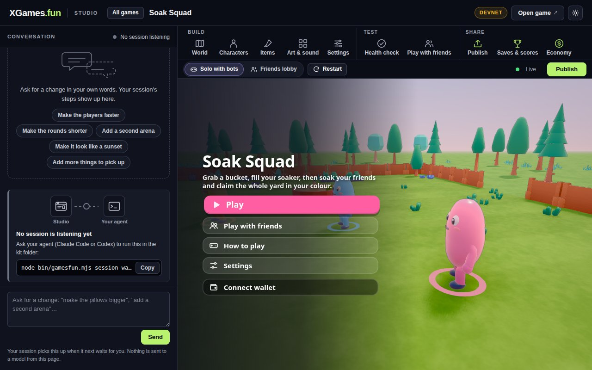

Click **Play** in the game. You run with W, A, S and D, look with the mouse, and spray with the mouse button. Seven
bots play against you. A round lasts a few minutes, then a results card shows and you can play again.

**If you do not get this far,** send us the whole text of the agent's answer, and the file made by this command (run
it in the `gamesfun-kit` folder; it holds no passwords):

```text
node bin/gamesfun.mjs doctor --json > doctor.json
```

## Eight things to try

Do them in order. Each one says what to do, what you should see, and what to send if it goes wrong. When we ask for a
file, its place is given from inside the `gamesfun-kit` folder.

### 1. Make a game from a sentence

**Do:** In your agent, type a sentence about a game you want. For example:

```text
Make me a game where we defend a lighthouse from crabs.
```

**You should see:**

- The agent offers two or three ideas. It may ask up to three short questions. Pick one idea.
- The agent builds it. This takes 10 to 30 minutes. It makes the game, checks it in Chrome (you will not see that
  Chrome window), and has a second agent play it as a new player.
- If the agent tries to stop before it is finished, it is told to go on. That is on purpose.
- At the end it says "delivered", tells you what you will see, and what it left out.
- Ask it: "open the new game in the studio". The game shows in the studio page. Play it. (A game you started from
  the studio's start page opens there by itself when it is delivered; until then that side says "Making your game".)

**If it goes wrong, send us:** the agent's last answer, and these two files (replace `<name>` with the game's folder
name, which the agent told you):

- `games/<name>/.gf-loop/state.json`
- the newest `verdict.json` inside `games/<name>/.gf-loop/job/out/` (it is in the folder `verify-1`, `verify-2`, … with
  the highest number)

### 2. Change a picture through a slot

Every picture, model, colour and number in a game is a "slot". You can swap one without touching code.

**Do:**

1. Have a picture of your own ready. A PNG file is best. Any picture works: it is laid over the lawn like a tile.
2. In the studio page, click the tool **Art & sound** (under Build, in the bar over the game).

   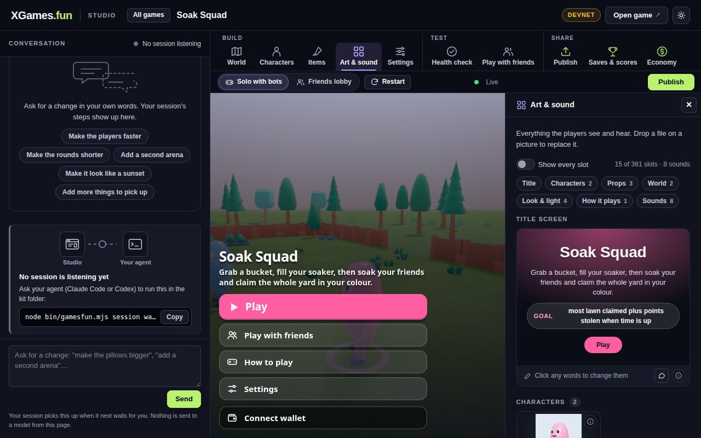

3. Turn on the switch **Show every slot**. Scroll down to the picture "Ground pattern".
4. Click **Replace** on that picture and choose your file (or drop the file on the picture).

**You should see:** the game on the left reloads by itself, and the lawn shows your picture. No code changed.

Before and after, with a picture of orange dots:

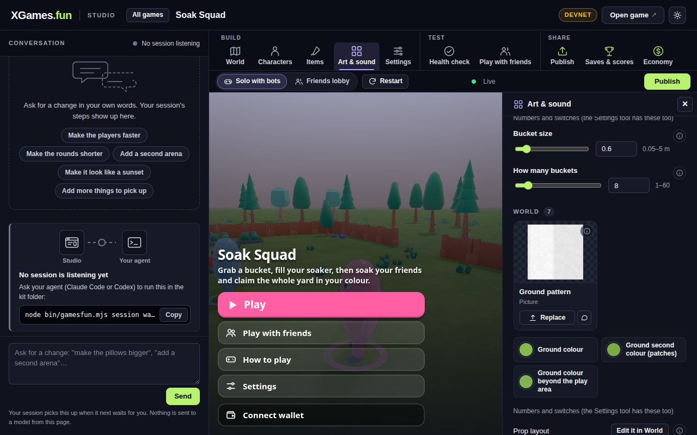

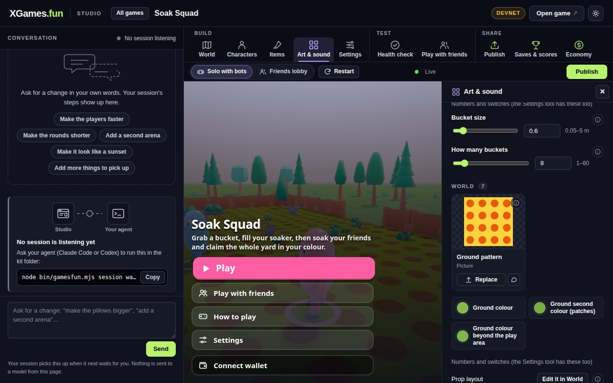

Then try two more:

- Change a colour in the same tool, or a number in **Settings**, for example "How many buckets". The game reloads and shows it.
- Ask your agent to do one for you, in your own words, with your own file's place:

  ```text
  In games/soak-squad, use the picture C:\Users\me\Pictures\dots.png for the ground pattern.
  ```

**If it goes wrong, send us:** the picture you used, a screenshot of the page, and the file `games/soak-squad/assets.json`.

### 3. Ask for a change in the studio page

This needs your agent session listening (the line's `session wait`, see above; Codex: type go after sending).

**Do:** In the studio page, click the tab **Session**. At the top it should say "Your session is listening" or "Your
session is working". Type a change in the box, for example "Make the grass pink", and click **Send to your session**.

**You should see:** your request appears under "Your requests". Its label goes from "Handed over to your session" to
"Seen" to "Done". Under "What your session did" you can follow its steps. Your agent then checks the game again, which
takes a few minutes. When it is done, the game in the page has changed.

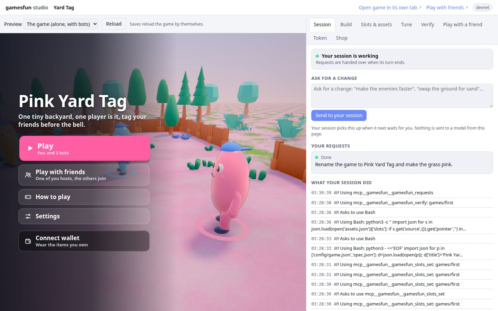

**If it goes wrong, send us:** a screenshot of the conversation (the left side of the studio), and what your agent's terminal shows. If the tab says
"No session connected yet", say so: that means the page and your agent did not find each other.

### 4. Answer a permission question in the page

**Do:** Tell your agent to do something it must ask permission for. For example:

```text
Run this command: node --version > out.txt
```

**You should see:** the question appears in your terminal, and also in the studio's conversation with two buttons, **Allow** and
**Deny**. Click **Allow** in the page. The agent goes on, and the terminal's question goes away. Ask again and click
**Deny**. The agent is told no.

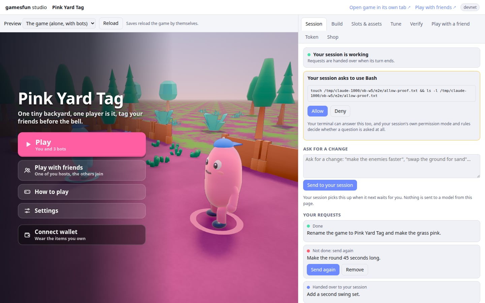

**If it goes wrong, send us:** a screenshot of the page and of the terminal at the moment the question is open. Tell us
which of the two showed the question, and what happened when you clicked.

### 5. Play with a friend in a second tab

**Do:**

1. In the studio page, click the tool **Play with friends** (under Test).
2. Click **1. Host a room in the preview**. In the game on the left, type a name (or keep the one it offers) and click
   **Host a game**.
3. Click **2. Open a second tab as your friend**. In the new tab, type another name and click **Join**.
4. Go back to the first tab and click **Start the game**.

**You should see:** both tabs list both names in the waiting room. After you start, both tabs are in the same round, and
each one shows the other player as a character that moves when the other tab moves.

The host's waiting room also has **Lock room** (multiplayer part 1.6.6 and newer; new games carry 1.7.0). While it is locked nobody new
can join (a friend opening the code sees "This room is locked"), and the host can start a round alone; **Unlock room**
undoes it. This page's screenshots do not show the button, and I have not clicked it by hand; the kit's verify check 34 plays it.

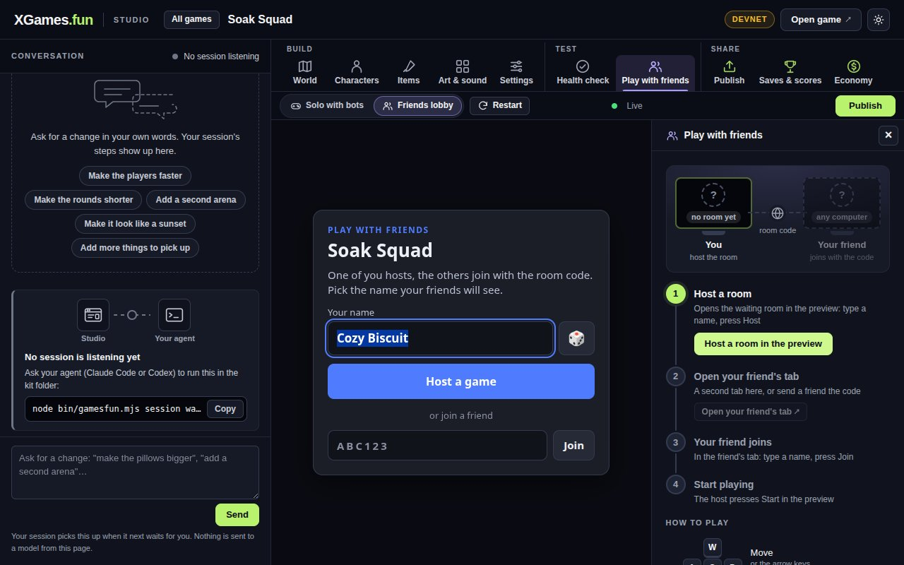

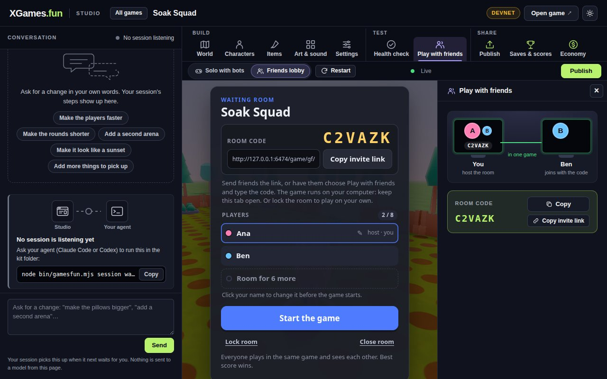

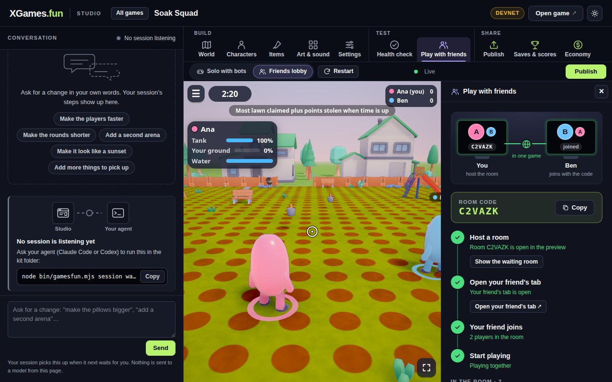

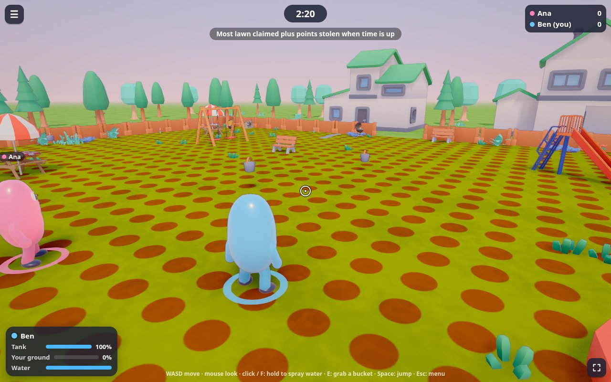

On a Mac, the system may ask whether Chrome may "find devices on your local network". Say **Allow**. If the second tab
never joins, this question is the first thing to check (System Settings, Privacy & Security, Local Network).

**If it goes wrong, send us:** a screenshot of each tab, and tell us at which of the four steps it stopped. Also send
`doctor.json` (see above).

### 6. Play with a friend on another machine

**Status: the kit side is done; the server side is games.fun's.** Two things have to be true before a friend on another
computer can join.

1. **The game must carry multiplayer part 1.6.4 or newer.** Since the sync of games.fun ed6c86ffa a game the kit makes
   carries 1.7.0 (since the sync of games.fun d78283f51; 1.6.6 before it), which knows online play. (Games made before that sync carry 1.6.3 and stay on this machine until
   `npx gamesfun upgrade <game>`.)
2. **Our server must accept games that people run themselves.** It introduces the two browsers to each other (a room
   code, then they connect directly). Whether it does is the play host's switch, not the kit's. This page has not
   been checked against the real server since the sync.

**What you see.** Run `node bin/gamesfun.mjs doctor`. The line **Online play** says
`online through games-fun-play.vercel.app: a game served by dev opens its rooms there ...`, or says the game is on this
machine only (an older game, `GAMESFUN_ONLINE=off`, or the server refusing or not answering). The studio's terminal
says the same in its `online` line. Thing 5 (a second tab) works as before either way.

**What you will see when the server accepts the game** (`doctor` says `online through games-fun-play.vercel.app`):

1. The studio's terminal says `online through games-fun-play.vercel.app: friends on other machines can join`.
2. Your friend needs the same game on their computer: the kit, and a copy of your game's folder in its `games` folder.
   They start it the same way (`node bin/gamesfun.mjs dev games/<your-game>`). A link that starts with
   `http://127.0.0.1` only works on the computer that made it, so do not send them yours.
3. You open **Play with friends** and host a room, as in thing 5. You get a six-letter room code.
4. Your friend opens the friends page of their own copy, chooses to join, and types your code. Both of you are then in
   the same round, each seeing the other as a character.

**If our server says no.** A small dark box at the top of the game says why, in words like these, and the game carries
on with this computer only (a second tab still joins, as in thing 5):

- "Online play is not available from this page: Online play for games run from other sites is off for now. ..." Our
  switch is off. It is not a fault in your game.
- "Online play could not be reached (games-fun-play.vercel.app did not answer this page)." No network, or our server
  did not answer.
- "The online host refused: Too many rooms from this network: try again in 12 minutes." A limit. Wait, or click
  **Play on this machine instead** in the box.

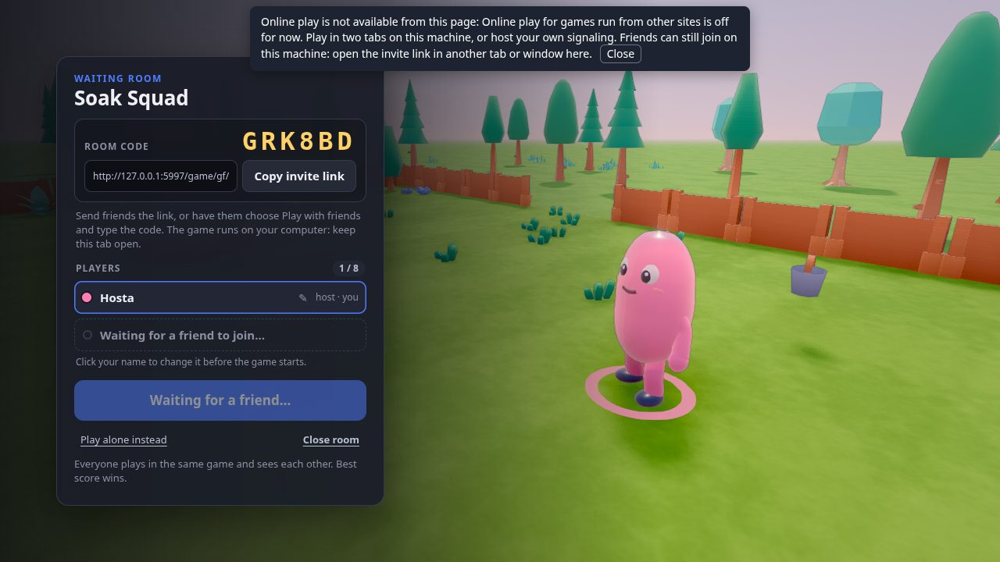

[docs/ONLINE.md](ONLINE.md) says what the limits are and how to run this small server yourself. In this kit its file
is `kits/research/multiplayer/p2p/serve-signal.mjs`. Starting the studio with `GAMESFUN_ONLINE=off` keeps a game on
this computer only; `GAMESFUN_ONLINE=https://YOUR-HOST/signal/v1` uses your own server.

**If it goes wrong, send us:** a screenshot of the game with the box at the top (if there is one), the whole address
from the address bar of both computers' game tabs (it shows which server was used, for example `?signal=`), the text
of the browser's console (in Chrome: View, Developer, JavaScript Console; above all the lines that start with
`gamesfun dev:`), the `online` line from the studio's terminal on both computers, and `doctor.json` from both.

### 7. Roll a round back

Each time your agent starts a round of work, the kit first keeps a copy of the game. You can go back to any copy.

**Do:** After thing 3 (a change made through the page), click the tab **Build**. Under "Roll back" is a list. Click
**Roll back to this** on the line just before your change.

**You should see:** "Rolled back". The game in the page reloads and looks as it did before the change. Your agent is
told what you did, and it does not put the change back.

If you roll back while the agent is still building, the build is cancelled. That is on purpose: rolling back means you
do not want what it was doing.

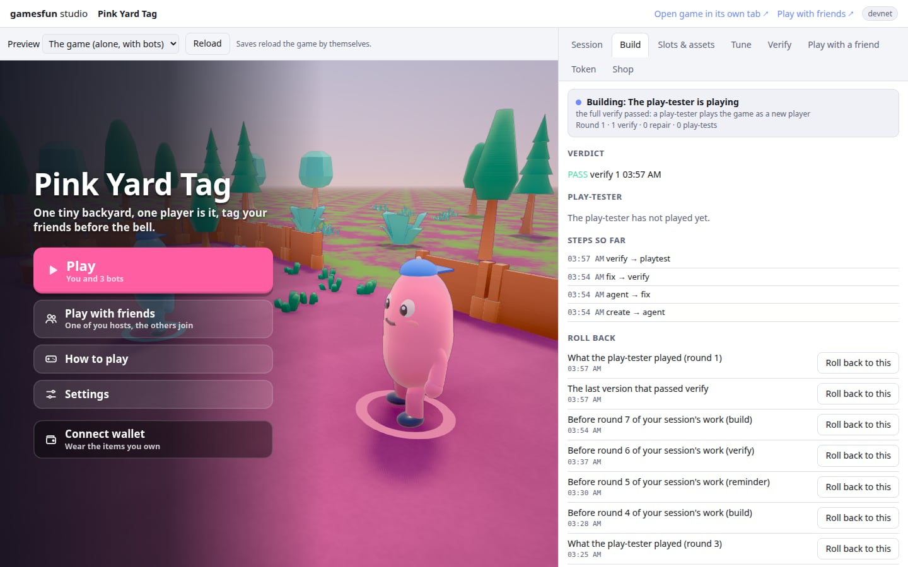

**If it goes wrong, send us:** a screenshot of the conversation (where the build's steps and roll-back points are), what the agent said next, and the file
`games/<name>/.gf-loop/state.json`.

### 8. Make the board game example

The first example is a party game: everyone plays at once until the clock runs out. This one is different. Players take
turns, on a giant board.

**Do:** Tell your agent:

```text
Make a game in games/board from the giant-four example and open it in the studio.
```

Or do it by hand, in the `gamesfun-kit` folder:

```text
node bin/gamesfun.mjs create games/board --from giant-four
node bin/gamesfun.mjs dev games/board
```

**You should see:** a town square with a blue board lying on the ground. Click **Play**. Under the clock the screen
says whose turn it is. When it says "Your turn", walk onto a column of the board and press E. Your disc slides in. Then
the other players take their turns, one at a time (alone you play one bot; the picture below has three). If you press E when it is not your turn, the game says "Not your turn". Four
discs in a row win. The clock at the top counts your turn down from 25 seconds. If it runs out, the game plays a disc
for you.

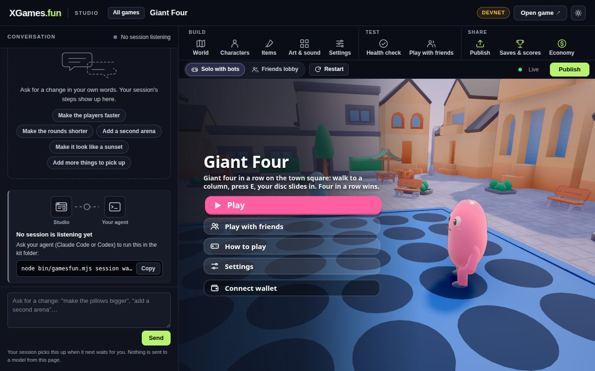

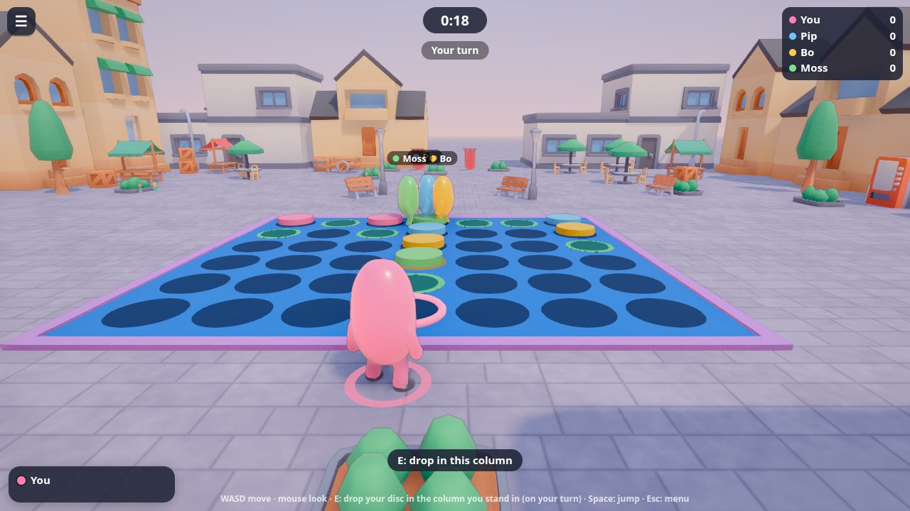

**If it goes wrong, send us:** a screenshot, and tell us what you pressed and what the game said.

## Seven more checks only a real machine can do

Our automatic tests run on rented machines with no real graphics card. These seven things have never been done on a
real Windows PC or Mac. Each takes a few minutes. Run the commands in the `gamesfun-kit` folder.

1. **The full check of a game.** This plays the game in Chrome with real keys and mouse, about 3 minutes:

   ```text
   node bin/gamesfun.mjs verify games/soak-squad --quick
   ```

   You should see a list of numbered checks and, at the end, a line that starts with `PASS`. Send us the newest
   `verdict.json` inside `games/soak-squad/evidence/` whether it passes or not.

2. **The second kind of game, with the better graphics.** It needs a real graphics card.

   ```text
   node bin/gamesfun.mjs create games/isle --from isle-run
   node bin/gamesfun.mjs dev games/isle
   ```

   You should see knights on floating islands, with shadows and soft light. Play a minute. Then stop the studio
   (press Ctrl and C in its terminal) and run `node bin/gamesfun.mjs verify games/isle --quick`. Send us the newest
   `verdict.json` inside `games/isle/evidence/`, and a screenshot of the game.

3. **Two players on one Mac.** This is thing 5 above, done on a Mac. Tell us whether the Mac asked about the local
   network, and whether the second tab joined.

4. **The waiting room's background.** In thing 5, look at the waiting room before you start the game. On a computer with
   a graphics card you should see the game's world behind the list of players. Send a screenshot.

5. **The short commands.** In a new PowerShell or Terminal window, in the `gamesfun-kit` folder:

   ```text
   npx gamesfun doctor
   ```

   You should see the same lines as before, and the line that starts with `Graphics` should name your real graphics
   card (not "SwiftShader" or "software"). Send us what it printed.

6. **A folder with a space or an accent in its name.** Make a folder such as `My Games` or `José`, and do "The one
   line" again inside it. Everything should work the same. On Windows also run this, and send us what it prints:

   ```text
   git config --get core.autocrlf
   npm test
   ```

   `npm test` should end with `fail 0`.

7. **A different browser setup.** If you can, try one of these and tell us which: a computer with only Microsoft Edge
   and no Chrome; Chrome installed "just for me" and not for all users; or no Chrome and no Edge at all (the kit then
   downloads its own browser, about 170 MB, the first time it checks a game, and says so).

## What to send when something goes wrong

For anything at all, these help most:

1. Which thing you were trying (its number on this page), and whether you are on Windows or a Mac.
2. A screenshot of the page in Chrome, and the text in your agent's terminal.
3. The file made by `node bin/gamesfun.mjs doctor --json > doctor.json`. It lists your system, Node, browser and
   graphics card. It holds no passwords and no keys.
4. The files named under the thing you were trying.

None of these files hold a password, a token or a key. The kit never asks for one, and neither should your agent.

## Where the screenshots come from

Every picture on this page is from a real run on Linux on 2026-10-11, with Chrome on a real graphics card. Pictures
1 to 10 were taken by `tests/try-it-shots.mjs` on the kit as it is now (the lawn has orange dots in the later ones
because the picture from thing 2 was still in place). The three pictures of the Session and Build
tabs (a request, a permission question, the roll-back list) are from a real Claude Code session that built a game that
day (`tests/e2e-live/README.md`). In those three, the row of tabs also shows "Token" and "Shop", and the corner says
"devnet". You will not see those: the Token and Shop tabs are gone, and the Economy tab that replaced them (a game's
whole economy on Solana devnet: its shop, loot boxes, lotteries, stakes and token; the `gamesfun-economy` skill) is
on by default (`GAMESFUN_WEB3=0` turns it off).

The picture in thing 6 is from `tests/online-e2e.mjs` (case B) on the same day: the example game on multiplayer part
1.6.4, with a stand-in for our server on this machine that says no in our server's own words. No picture on this page
is from our real server.
